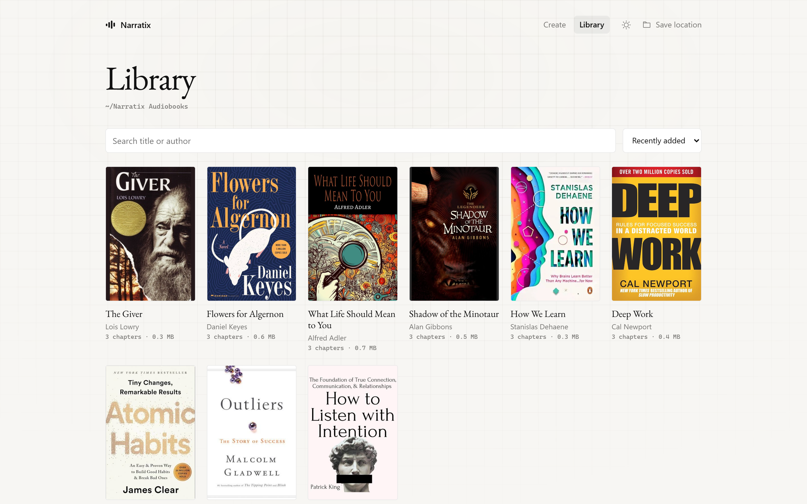
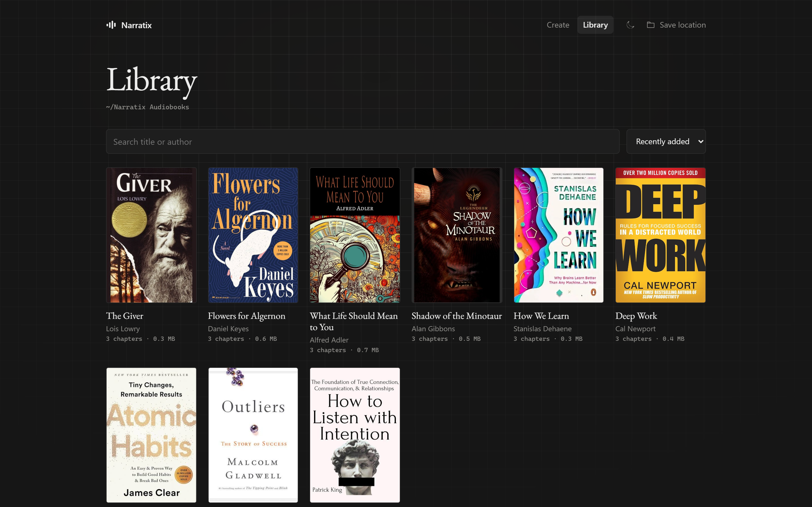
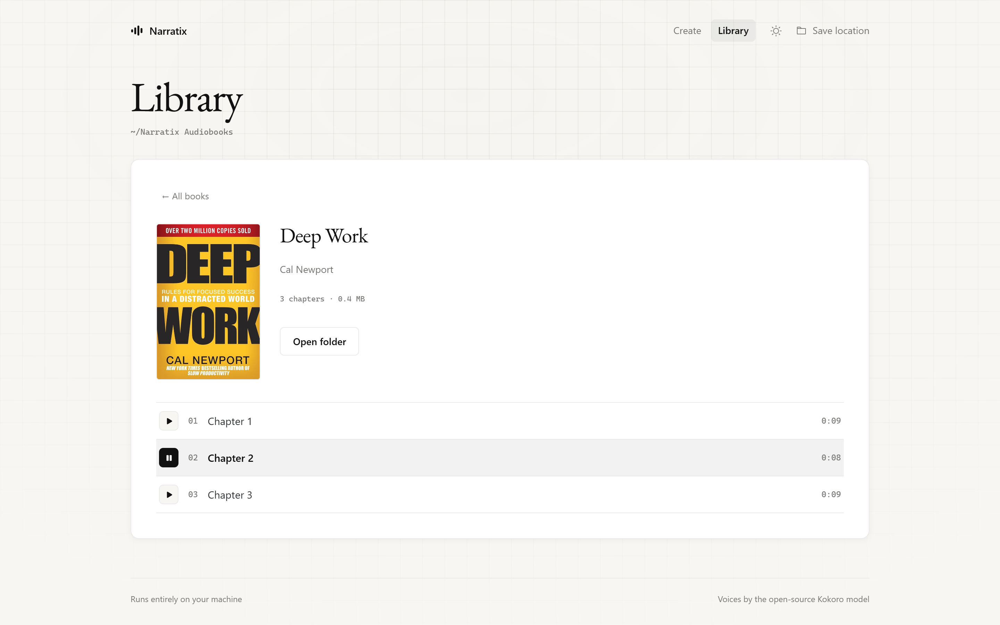
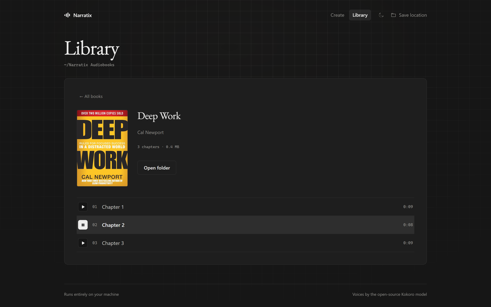

# Narratix

Turn any EPUB into an MP3 audiobook, entirely on your own machine. It uses the open-source [Kokoro](https://github.com/thewh1teagle/kokoro-onnx) voice model on your CPU. No accounts, no API keys, and no network calls after a one-time model download.

<table>
  <tr>
    <td width="50%"></td>
    <td width="50%"></td>
  </tr>
  <tr>
    <td width="50%"></td>
    <td width="50%"></td>
  </tr>
</table>

*The screenshots show popular books, and their public cover images, for demonstration only. The audio is placeholder text. No book content is included in this repository.*

## Features

- Web app with 18 voices (American and British), previews, and a library with chapter playback
- Per-chapter MP3s with ID3 tags and cover art, saved to a folder you choose
- Command-line interface for scripting
- Fully offline once set up

## Quick start

Needs Python 3.9+ and [ffmpeg](https://ffmpeg.org/) on your `PATH`.

```bash
pip install -r requirements.txt
python scripts/download_models.py   # one-time, ~350 MB
python -m narratix                  # opens http://127.0.0.1:8000
```

Each book is saved as `<save folder>/Title - Author/` (the name format is configurable), ready for any audiobook player.

## Command line

```bash
python -m narratix.cli book.epub --voice bm_george --rate +10%
python -m narratix.cli --list-voices
```

## License

MIT. The Kokoro model is Apache-2.0.
